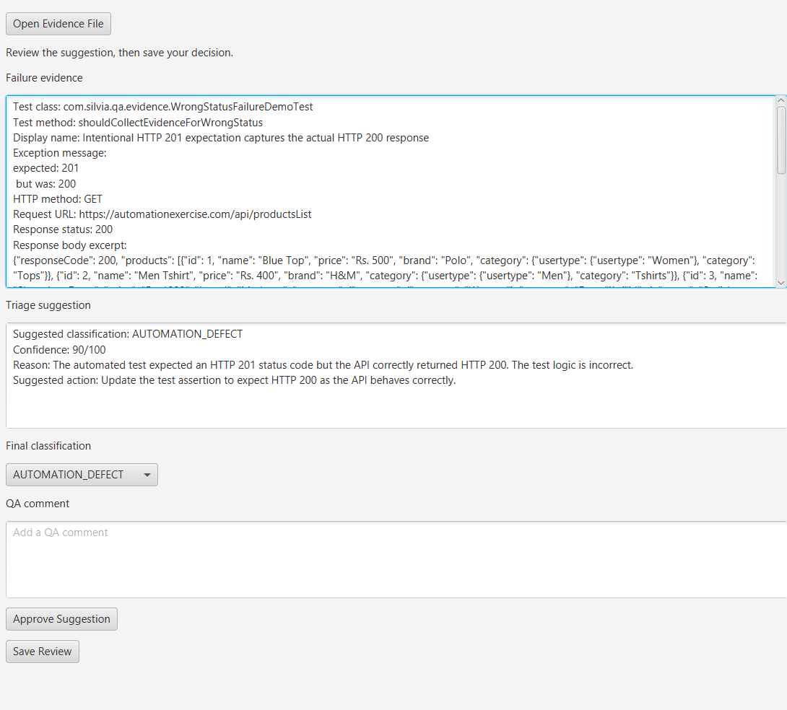
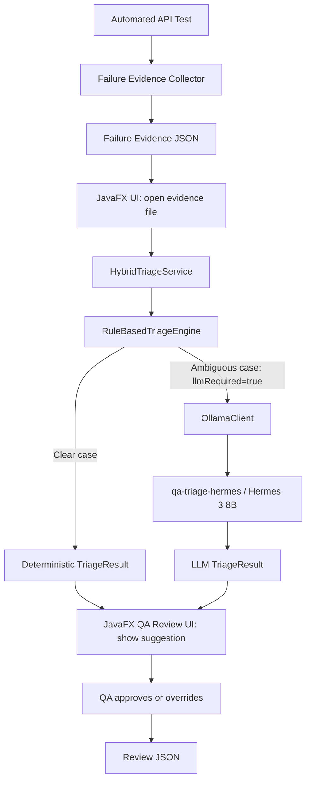
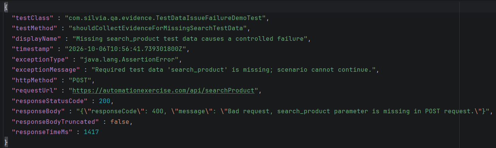
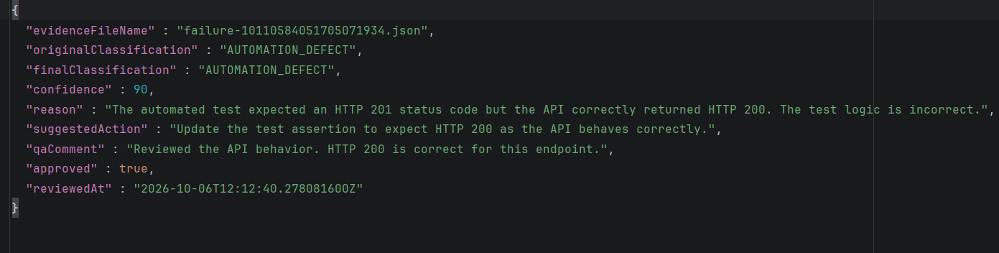

# QA Failure Triage Agent

A Java 21 QA failure triage system that combines structured API evidence, deterministic rules, local Hermes suggestions, and human review.

## Project Overview

A failed automated test does not always mean the application is broken. Incorrect assertions, missing test data, and environment problems can produce similar failures. Triage helps QA reviewers identify the most useful next investigation step instead of treating every failure as a product defect.

The project connects failure diagnostics to a reviewable QA decision, with suggestions from Java rules or a local Hermes 3 8B model through Ollama. It is a small portfolio implementation, not a production-ready system.

**Latest validated suite:** 33 passing tests, 5 skipped, 0 failures or errors.



*JavaFX reviewer with a loaded failure and triage suggestion.*

## Architecture



Collection and review are separate steps: the reviewer opens an existing evidence file. Tests opt into collection by registering `FailureEvidenceExtension` and attaching its API filter.

## Current Features

- Java 21 and Maven; JUnit 5, REST Assured, and AssertJ for testing.
- Jackson serialization and structured failure evidence JSON under `target/failure-evidence/`.
- HTTP exchange capture, response timing, and response body truncation at 3,000 characters.
- Conservative deterministic pre-triage rules and an explicit LLM routing flag.
- Local Ollama integration using Java 21 `HttpClient`, with validated JSON output.
- Custom `qa-triage-hermes` model configuration based on Hermes 3 8B.
- JavaFX human-in-the-loop review UI and review JSON under `target/qa-reviews/`.
- Unit tests using a local HTTP stub, plus a disabled real Ollama integration test.

## Failure Classifications

| Classification | Meaning |
| --- | --- |
| `PRODUCT_DEFECT` | Application behavior is incorrect compared with expected business behavior. |
| `AUTOMATION_DEFECT` | Test logic, assertions, expected values, locators, waits, or automation implementation are incorrect. |
| `TEST_DATA_ISSUE` | Required test data is missing, invalid, expired, inconsistent, or unsuitable. |
| `ENVIRONMENT_ISSUE` | Infrastructure, network, service or dependency availability, timeout, or environment configuration caused the failure. |
| `UNKNOWN` | Evidence is insufficient to reliably identify the cause. |

`UNKNOWN` is intentional: a generic HTTP 500 alone does not establish a product or environment defect.

## Hybrid Triage Strategy

`HybridTriageService` uses Java rules for explicit missing required input and narrowly defined incorrect expectations paired with successful API responses. A status mismatch alone does not prove an automation defect.

Generic server errors and unmatched evidence return `UNKNOWN` with `llmRequired=true` and are routed to Ollama. Output is validated for required fields, classification, and integer confidence from 0 to 100. QA remains responsible for the final classification.

The [Modelfile](Modelfile) provides persistent system instructions and few-shot examples. It does not train or fine-tune the model or change its weights. Recreating the custom model applies changes to those instructions.

## Evidence Example

The following uses the current `FailureEvidence` fields. HTTP status and the API's application-level `responseCode` are distinct.

```json
{
  "testClass": "com.silvia.qa.evidence.TestDataIssueFailureDemoTest",
  "testMethod": "shouldCollectEvidenceForMissingSearchTestData",
  "displayName": "Missing search_product test data causes a controlled failure",
  "timestamp": "2026-10-06T10:56:41.739301800Z",
  "exceptionType": "java.lang.AssertionError",
  "exceptionMessage": "Required test data 'search_product' is missing; scenario cannot continue.",
  "httpMethod": "POST",
  "requestUrl": "https://automationexercise.com/api/searchProduct",
  "responseStatusCode": 200,
  "responseBody": "{\"responseCode\":400,\"message\":\"Bad request, search_product parameter is missing in POST request.\"}",
  "responseBodyTruncated": false,
  "responseTimeMs": 1417
}
```



*An evidence file generated by the failure collector.*

## Triage Result Example

```json
{
  "classification": "TEST_DATA_ISSUE",
  "confidence": 95,
  "reason": "The failure explicitly identifies missing required test input.",
  "suggestedAction": "Supply the missing required value in the test fixture."
}
```

These are the four model-output fields. Java's `TriageResult` also contains `llmRequired`, which controls routing; the client sets it to `false` after successful model inference.

## Human Review Example

```json
{
  "evidenceFileName": "failure-example.json",
  "originalClassification": "TEST_DATA_ISSUE",
  "finalClassification": "TEST_DATA_ISSUE",
  "confidence": 95,
  "reason": "The failure explicitly identifies missing required test input.",
  "suggestedAction": "Supply the missing required value in the test fixture.",
  "qaComment": "Confirmed that the fixture omits the required search term.",
  "approved": true,
  "reviewedAt": "2026-10-06T12:00:00Z"
}
```

`approved` is true when the final classification matches the original suggestion and false when it differs. Each save creates a separate review file; the original evidence is preserved.



*Saved review JSON recording the QA decision.*

## Running the Project

Requirements: Java 21, Maven (standalone or bundled with IntelliJ IDEA), and Ollama for real LLM inference. Normal API tests require internet access to Automation Exercise; stub-based triage tests do not require Ollama.

From the project root, with Ollama installed and its local service running:

```bash
ollama pull hermes3:8b
ollama create qa-triage-hermes -f Modelfile
ollama run qa-triage-hermes
```

The Java client uses `http://localhost:11434/api/generate` with model `qa-triage-hermes`, `stream=false`, and JSON output format. The interactive `ollama run` command is useful for checking the model; Java calls the service directly.

Run the normal suite or launch the desktop reviewer:

```bash
mvn test
mvn javafx:run
```

In the UI, choose **Open Evidence File**, review the displayed evidence and suggestion, select the final classification, add an optional QA comment, and choose **Save Review**. **Approve Suggestion** resets the selection to the suggested classification; saving records the decision.

<details>
<summary>Windows: use IntelliJ's bundled Maven when mvn is unavailable on PATH</summary>

```powershell
& 'C:/Program Files/JetBrains/IntelliJ IDEA 2026.2.3/plugins/maven-plugin/lib/maven3/bin/mvn.cmd' test
& 'C:/Program Files/JetBrains/IntelliJ IDEA 2026.2.3/plugins/maven-plugin/lib/maven3/bin/mvn.cmd' javafx:run
```

Adjust the installation path for your IntelliJ version.

</details>

## Tests

Latest validated suite: **33 passing tests, 5 skipped tests, 0 failures or errors**.

| Test group | Coverage |
| --- | --- |
| API tests | Product listing, product search, missing search parameter rejection, and unsupported method handling. |
| `RuleBasedTriageEngineTest` | The three deterministic rules and conservative fallback cases. |
| `HybridTriageServiceTest` | Routing, HTTP request shape, JSON parsing, invalid output, and HTTP errors using a local stub. |
| `ReviewRecordWriterTest` | Saved fields, approval semantics, separate files, and output errors; no JavaFX interaction. |
| Disabled failure demos | Four controlled failures for evidence generation. |
| `HybridTriageOllamaIntegrationTest` | Real local inference and result structure; disabled by default. |

For manual evidence generation, temporarily remove `@Disabled` from one demo class and run it alone, for example:

```bash
mvn -Dtest=TestDataIssueFailureDemoTest test
```

The demo intentionally fails and writes evidence JSON. Restore `@Disabled` afterward. To validate real inference, temporarily enable the integration test and run:

```bash
mvn -Dtest=HybridTriageOllamaIntegrationTest test
```

It checks the result structure without requiring an exact classification. Restore `@Disabled` before normal suite runs.

The JavaFX review workflow has also been manually validated end-to-end by loading failure evidence, reviewing the suggested classification, adding a QA comment, and saving the final review JSON.

## Project Structure

```text
Modelfile
pom.xml
src/main/java/com/silvia/qa/
  api/                 API endpoint constants
  config/              Base URL configuration
  evidence/            FailureEvidence record and JSON writer
  triage/              Classifications, results, rules, hybrid service
    llm/               Ollama HTTP client and request/response records
  ui/                  JavaFX reviewer and review JSON writer
src/test/java/com/silvia/qa/
  api/                 Passing API tests
  evidence/            Disabled controlled failure demos
  support/evidence/    JUnit evidence extension and REST Assured filter
  triage/              Rule, stub, and disabled real-inference tests
  ui/                  Review writer unit tests
target/
  failure-evidence/    Generated failure JSON
  qa-reviews/          Saved human review JSON
```

## Design Decisions

- **Local LLM:** avoids a paid hosted API and supports local inference.
- **Java HttpClient:** uses the JDK rather than an additional HTTP library.
- **Jackson:** reuses one JSON library for evidence, inference, and review records.
- **Reviewable decisions:** retain the original suggestion alongside the final QA classification and comment.
- **Disabled integration tests:** keep normal runs independent of local model availability; intentional failure demos are also disabled.

## Limitations

- Automation coverage is intentionally small and focused on public demo APIs.
- The five-category taxonomy and deterministic rule matching are limited.
- Local LLM output is probabilistic; valid JSON does not guarantee a correct diagnosis. Confidence is not a calibrated probability.
- Evidence captures the latest HTTP exchange, not server logs, request payloads, or a complete execution trace.
- Real Ollama integration requires the local service and custom model to be available. HTTP or parsing errors propagate; there are no retries.
- There is no database, dashboard, authentication, or implemented browser automation workflow.

## Future Improvements

- UI/Selenium failure evidence and screenshots.
- Flaky-test analysis.
- A CI pipeline.

## Portfolio / Learning Goals

The project demonstrates API automation, Java framework design, failure diagnostics, structured evidence, local LLM integration, hybrid deterministic + AI decision logic, and a human-in-the-loop QA workflow. Its focus is making failure analysis understandable and reviewable while keeping the implementation small enough to explain in a technical interview.
